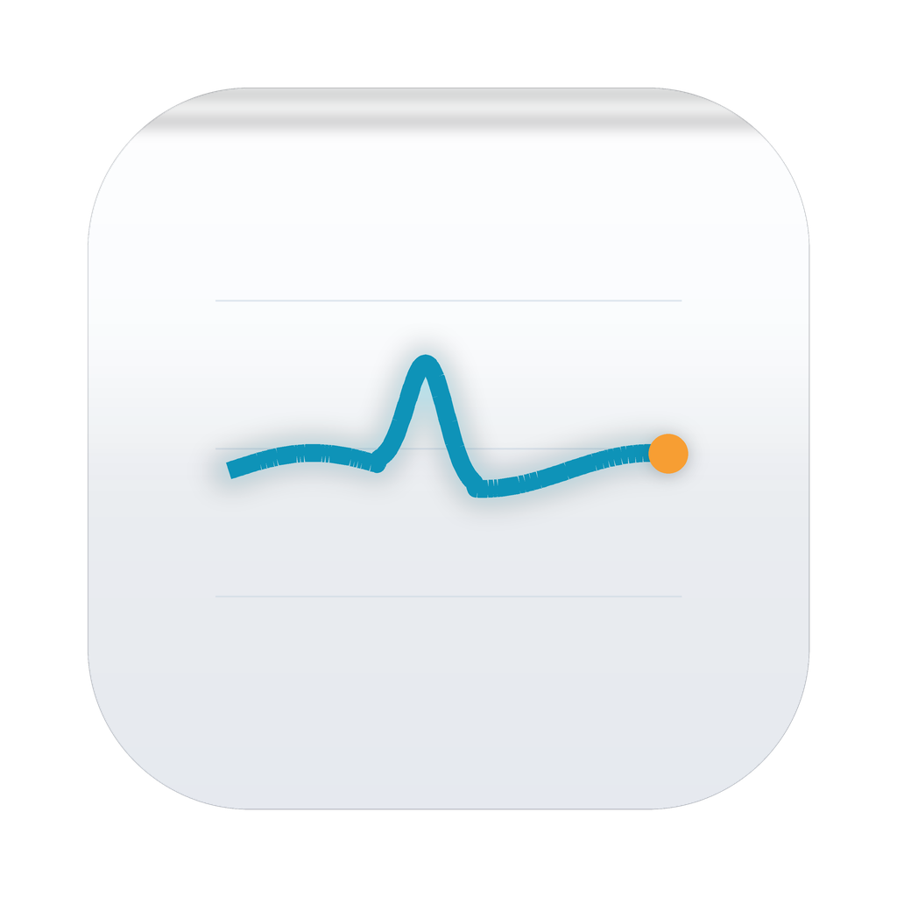
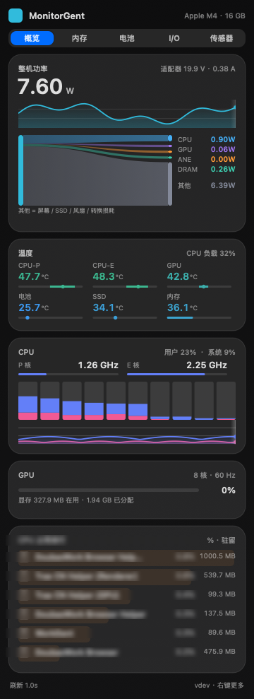
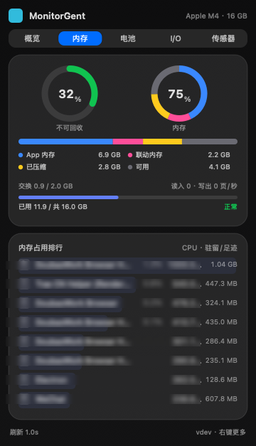
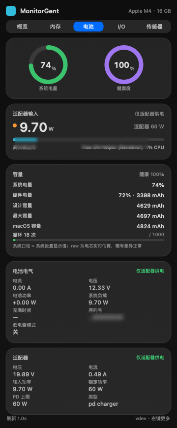
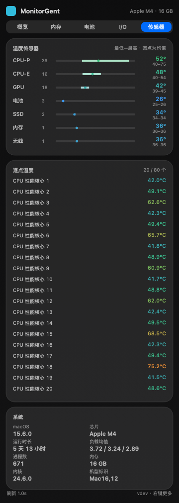
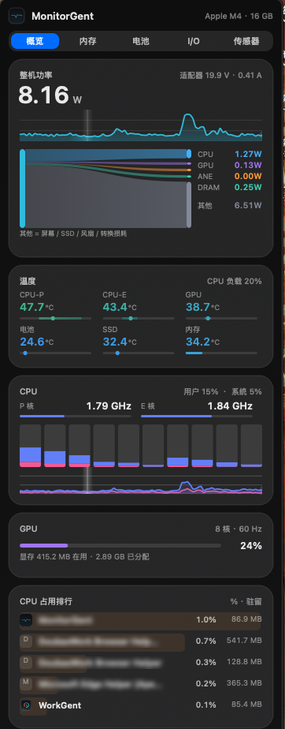

  

<h1 align="center">MonitorGent</h1>

macOS 菜单栏硬件监测：功率、温度、内存、电池、I/O，一眼看完。

  
  
  

> 本仓库仅用于产品展示与问题反馈，**不包含源代码**（闭源软件）。

---

## 是什么

MonitorGent 是一个 macOS 菜单栏硬件监测工具。菜单栏常显「内存压力环 + 温度」，点开是一个深色面板，把整机功率、SoC 分解、温度、内存、电池和 I/O 放在同一屏里，刷新间隔 1 秒。

面向 Apple Silicon（M 系列）机器，数据全部来自本机 IOKit / sysctl，不联网。

## 功能

**菜单栏**
- 圆环显示内存压力百分比，旁边跟温度，例如 `⬤ 47% ｜ 🌡 29.7°C`
- 数字用中性色，彩色只留给压力环和温度计，混在系统图标里不刺眼

**概览**
- 整机功率曲线（瓦特），标注适配器电压 / 电流
- SoC 功率分解：CPU / GPU / ANE / DRAM / 其他
- CPU-P、CPU-E、GPU、电池、SSD、内存温度
- P 核 / E 核实时频率与占用
- GPU 占用、显存

**内存**
- 内存压力环 + 已用内存环
- 四段构成条：App / 联动 / 已压缩 / 可用
- 交换分区读写、内存占用进程排行
- 「不可回收」按 `(wired + compressed) / total` 计算，压力等级直接读内核 `kern.memorystatus_vm_pressure_level`，与「活动监视器」一致

**电池**
- 电量与健康度双环
- 适配器输入功率、是否已接电源、适配器额定功率
- 设计容量 / 最大容量 / 当前容量 / 循环次数
- 电池电压、电流、系统负载、充电状态、序列号

**传感器**
- CPU-P / CPU-E / GPU / 电池 / SSD / 内存 / 无线温度，显示最低–最高–均值

**其他**
- 开机自启（`SMAppService`，失败自动回退 LaunchAgent）
- 无 Dock 图标，只驻留菜单栏
- 全部本地读取，无网络请求

## 截图

| 概览 | 内存 |
|---|---|
|  |  |

| 电池 | 传感器 |
|---|---|
|  |  |

菜单栏与功率曲线：

## 系统要求

- macOS 13.0 或更高版本
- 面向 Apple Silicon 优化；Intel 机型未做验证

## 版本

当前版本 **0.9.2（build 11）**，详见 [CHANGELOG.md](CHANGELOG.md)。

## 下载

DMG 分发包（`MonitorGent-0.9.2.dmg`）**未做 Apple 公证**，首次打开会被 Gatekeeper 拦一次，属正常现象：

1. 把 `MonitorGent.app` 拖进「应用程序」
2. 右键 `MonitorGent.app` → 打开 → 再点「打开」
3. 若仍打不开，终端执行一次 `xattr -dr com.apple.quarantine /Applications/MonitorGent.app`

包内附 `安装说明.txt`。需要公开分发时再补 Developer ID 证书与公证。

如需试用或反馈问题，也可在本仓库开 Issue。

## 隐私

- 只读取本机硬件传感器与系统计数器（IOKit / sysctl / SMC）。
- 不联网、不上传任何数据、不包含统计上报。

## 许可

专有软件，**源码不公开**。本仓库中的文字与图片仅用于产品介绍，未经许可不得复制、修改或再分发。详见 [LICENSE](LICENSE)。

## 反馈

- Bug / 建议：GitHub Issues
- 作者：[@baikaylyn](https://github.com/baikaylyn)
